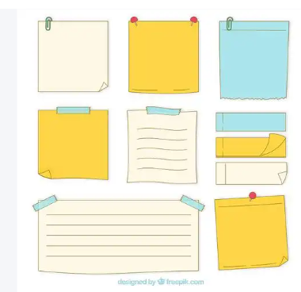
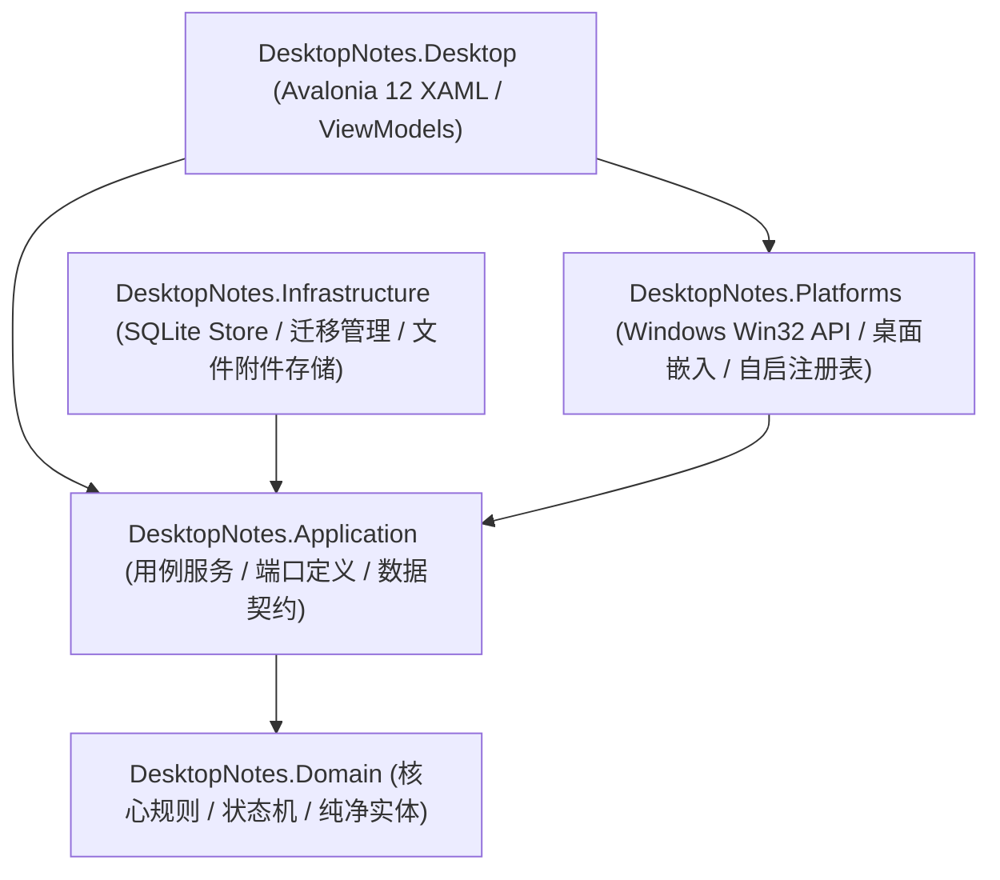

<div align="center">


# 电子便签 · Sticky Notes

**桌面上的温暖与秩序 · 优雅治愈的拟真便利贴与待办事项助手**

[-0078D6?logo=windows&logoColor=white)](#)
[](#)
[](#)
[-003B57?logo=sqlite&logoColor=white)](#)
[-10B981)](#)
[](#)
[](#)

<br/>


</div>

---

## 📖 项目简介

**电子便签（Sticky Notes）** 是一款专为 Windows 桌面打造的**轻量、治愈、高质感**电子便签与待办事项管理软件。

它打破了传统待办软件刻板生硬的表格感，创新性地将**写实便签纸张美学**与**现代高效待办系统**深度融合：
既有泛着微光的暖黄色曲面纸张、立体红色图钉与生机绿植嫩苗，又有清晰的多级子任务树、月历全景追踪、误操作历史撤销与 100% 离线本地数据存储。不论是日常工作清单、头脑风暴备忘，还是长期目标拆解，电子便签都能成为你桌面上最舒心、最得力的高效伙伴。

---

## ✨ 核心特色功能

### 1. 🎨 写实便利贴与现代极简双风格

支持在主窗口菜单或系统托盘中**一键无缝切换**，兼顾视觉治愈感与极致生产力：

| 风格模式 | 视觉特征与体验 |
| :--- | :--- |
| **写实拟物便签 (Realistic)** | 拟真双层微卷纸张边缘、3D 立体红色大图钉、真实阴影凹痕、右下角立体翻折折痕、清新手写体与萌趣待办图标（待完成绿植嫩苗 🌱，已完成浪漫粉花 🌸）。 |
| **现代极简模式 (Minimalist)** | 极简 Fluent 毛玻璃质感半透明卡片、精致高对比度状态标签、清晰的层级引导折线与紧凑信息排版。 |

<div align="center">
  <table border="0">
    <tr>
      <td align="center" width="50%">
        <b>写实便签风格 (Realistic Note)</b><br/><br/>
        
      </td>
      <td align="center" width="50%">
        <b>现代极简风格 (Minimalist Fluent)</b><br/><br/>
        
      </td>
    </tr>
  </table>
</div>

---

### 2. 🌲 多级树形子任务与拖拽排布

- **无限层级拆解**：支持主任务下创建多级子任务（父任务 → 子任务 → 孙任务），条理清晰。
- **状态联动流转**：勾选父任务完成时可级联同步子任务，子任务独立折叠/展开，保持便签清爽整洁。
- **自由拖拽归属**：支持鼠标直接拖拽任务行调整上下显示顺序，或拖动到指定任务上方自动转为该任务的子任务。

---

### 3. ↩️ 误拖拽历史撤销（Undo）防误触机制

在整理任务时如果不小心将某项重要任务误拖入了其他任务成为子任务，无需慌张：
- 打开「**系统设置 → 撤销最近拖拽操作**」；
- 系统记录精准的操作堆栈，支持一键将任务层级与原始顺序原路恢复。

---

### 4. 📅 任务月历全景追踪与浮窗预览

不再错过任何重要里程碑与截止日期：
- **月历视图总览**：直观展示整月任务分布，当日日期高亮凸显。
- **动态图标标记**：有待办事项的日期标记生机嫩苗 🌱 与任务计数，有完成事项的日期标记粉色小花 🌸。
- **悬浮速览卡片**：鼠标悬停在任意日期格上，即刻弹出该日期的所有任务详情浮窗，省去频繁点击。

<div align="center">
  
</div>

---

### 5. 📝 任务详情备忘与受管附件

双击任意任务即可展开详情工作台：
- **Markdown 笔记编辑**：支持长文本备忘录、加粗、列表、代码段等丰富排版。
- **受管附件拖拽关联**：直接拖拽任意本地文件（图片、Office 文档、压缩包等）至窗口即可完成归档，文件由应用受管存储，原文件移动或删除均不影响便签查看。
- **优先级与截止日设置**：四级优先级色彩标识（P0 紧急、P1 高、P2 中、P3 低）与截止日期智能提醒。

<div align="center">
  
</div>

---

### 6. 📌 桌面窗口层级管理与开机自启动

- **多模式层级切换**：
  - **窗口置顶 (Topmost)**：常驻所有应用最前端，随手记录灵感与待办；
  - **嵌入桌面底层 (Desktop)**：置于所有常规窗口下方，贴合桌面壁纸，不干扰正常工作；
  - **位置锁定 (Lock)**：一键锁定窗口屏幕位置与尺寸，防止误触拖动；写实模式下大图钉会真实“钉入”桌面。
- **开机自动启动**：支持随 Windows 登录自动启动，自动记忆上次关闭时的屏幕坐标、窗口尺寸与图钉锁定状态。

---

### 7. 🗑️ 安全回收站与防误删双重确认

- 误删任务自动移入**回收站**，随时可一键撤回恢复。
- 回收站清空功能配有**二次弹窗确认**，严格防止重要笔记数据意外永久丢失。

---

### 8. 🔒 100% 纯本地离线与数据隐私

- **零联网依赖**：所有数据完整保存在本地 `%LOCALAPPDATA%\DesktopNotes\data\app.db`。
- **工业级 SQLite + WAL 机制**：确保多并发写入时不损坏、不丢失数据。
- **绿色安全**：不收集任何用户隐私、无广告、无弹窗推广。

---

## 🛠️ 技术架构

项目基于现代 **.NET 10** 与 **Clean Architecture (领域驱动 / 六角架构)** 构建，分层清晰，解耦彻底：



- **全覆盖自动化测试**：工程内包含 **66 个自动化测试**，包括 15 个纯领域业务规则测试与 51 个跨层/UI/数据库集成测试，确保长期演进零退化。

---

## 🚀 下载与安装

### 方式一：直接安装（推荐 Windows 用户）

1. 下载项目根目录下的独立安装程序：[`电子便签-v1.0-Setup.exe`](./电子便签-v1.0-Setup.exe)；
2. 双击打开安装向导：
   - 支持**自由选择安装目标路径**（如 `D:\Program Files\电子便签`）；
   - 支持勾选「**开机自动启动电子便签**」；
   - 自动在桌面与开始菜单生成高清可爱的便签图钉专属图标；
3. 安装完成后即可立即体验。

### 方式二：从源码构建运行

#### 准备环境
- 安装 [.NET 10.0 SDK](https://dotnet.microsoft.com/download/dotnet/10.0) 或更高版本
- Windows 10 / 11 操作系统（推荐）

#### 获取源码与运行
```bash
# 1. 克隆代码仓库
git clone https://github.com/your-repo/DesktopNotes.git
cd DesktopNotes

# 2. 编译并运行
dotnet run --project src/DesktopNotes.Desktop

# 3. 运行全量单元与集成测试
dotnet test
```

#### 打包自包含安装包
```bash
# 发布 Win-x64 自包含免安装包
dotnet publish src/DesktopNotes.Desktop -c Release -r win-x64 --self-contained true -o ./publish/win-x64

# 使用 Inno Setup 编译器生成单文件安装包
iscc installer/windows/DesktopNotes.iss
```

---

## ⌨️ 常用快捷操作

| 操作场景 | 快捷操作方式 |
| :--- | :--- |
| **新建待办** | 在底部输入框输入内容后按 `Enter` 回车快速添加 |
| **完成 / 取消完成** | 单击任务行左侧的萌趣小嫩苗 🌱 或圆圈勾选框 |
| **查看与编辑详情** | 双击任意任务行进入详情窗口 |
| **删除任务** | 单击任务行，点击右侧出现的垃圾桶图标即可移入回收站 |
| **拖拽排序 / 转为子任务** | 按住任务行左侧拖拽把手上下拖动（拖至其他任务行内即变为子任务） |
| **展开 / 折叠子任务** | 点击父任务左侧的三角展开箭头 `▶` / `▼` |
| **右键快捷菜单** | 右键单击顶部图钉栏唤醒「应用全局设置」；右键单击具体任务唤醒「任务专项菜单」 |
| **撤销误拖拽** | 进入「设置 → 撤销最近拖拽」一键还原 |
| **中英文切换** | 顶部图钉右键菜单 → 语言设置 → 切换「中文 / English」 |
| **风格切换** | 顶部图钉右键菜单 → 视觉风格 → 切换「拟真便签 / 极简模式」 |

---

## 📄 开源许可证

本项目基于 [MIT License](LICENSE) 协议开源，供个人与商业用户免费使用与学习交流。
