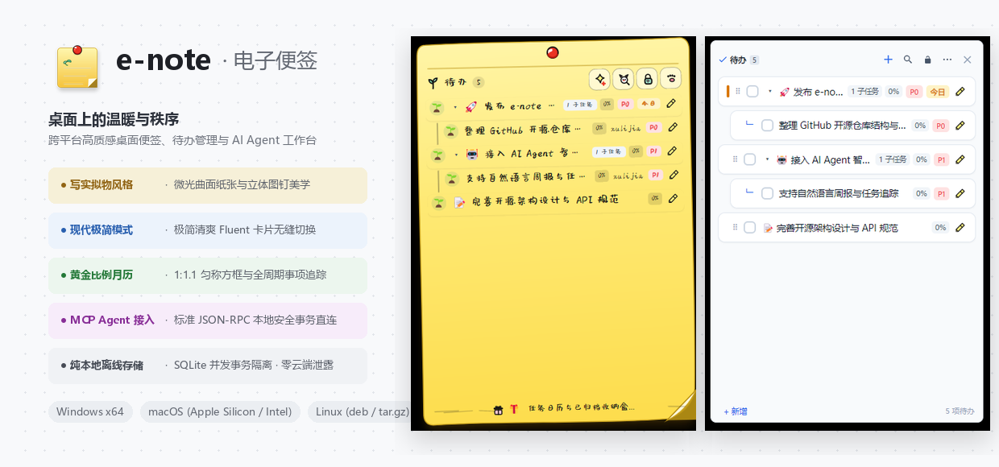
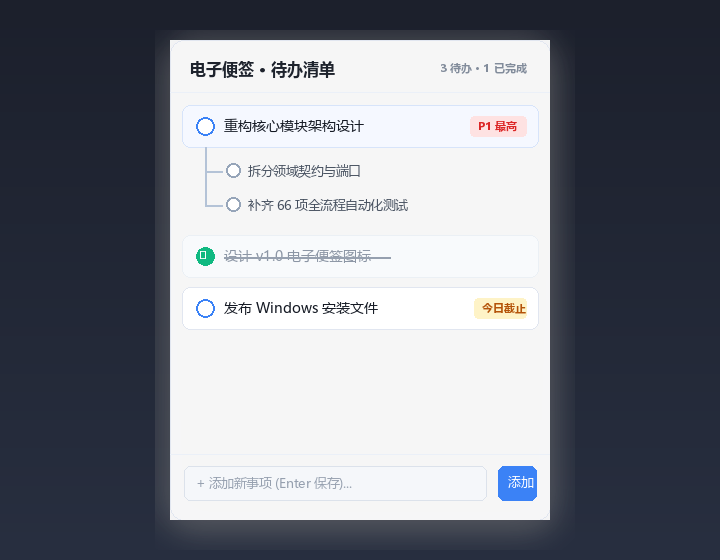
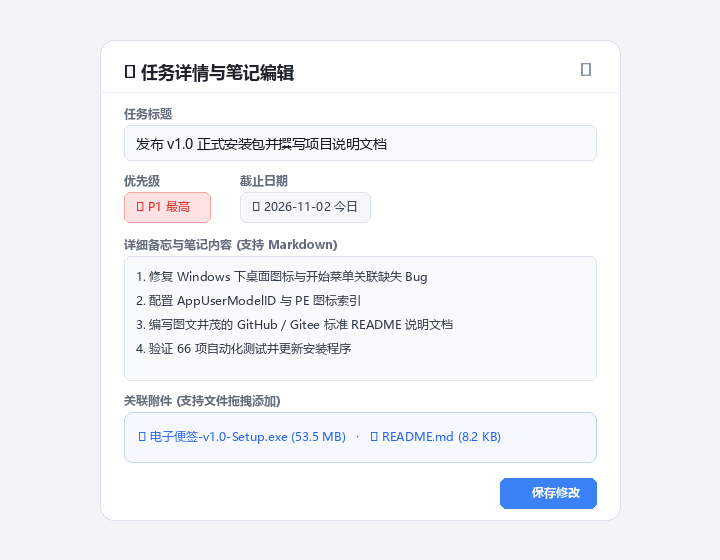
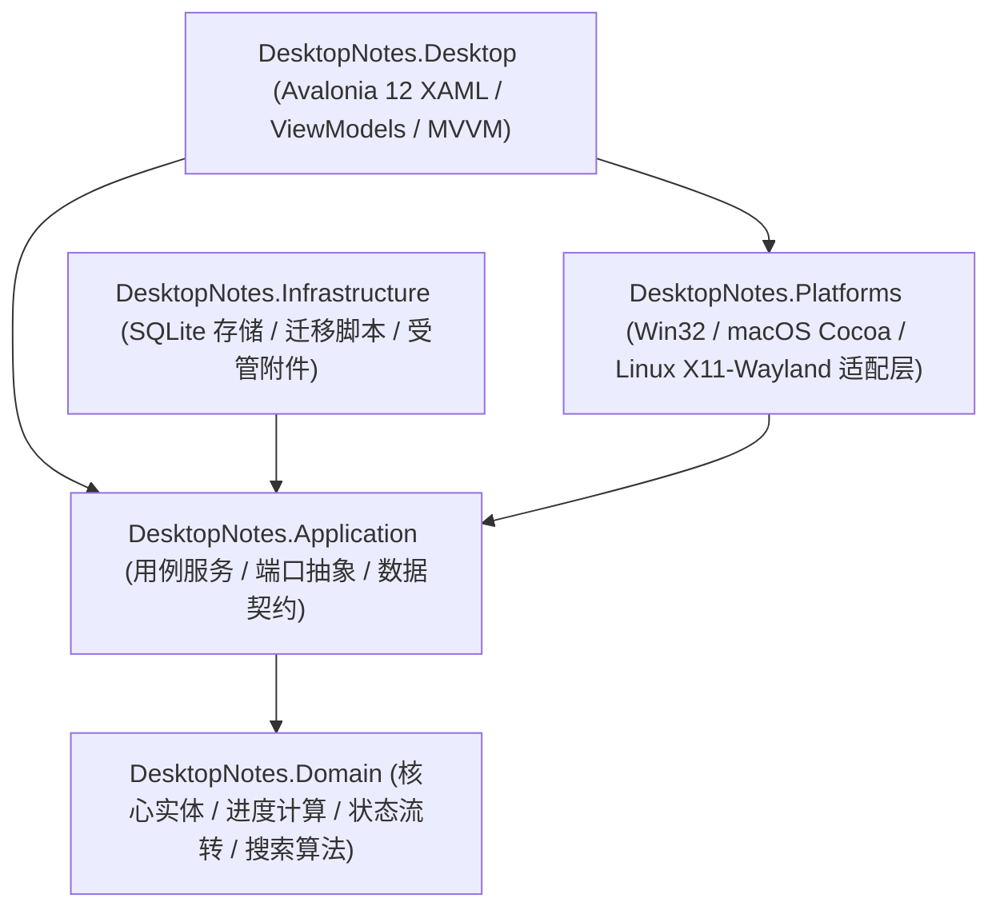

<div align="center">


# e-note · 电子便签

**桌面上的温暖与秩序 · 跨平台高质感桌面便签、待办管理与 AI Agent 工作台**

[English](README_EN.md) | [简体中文](README.md)

[](#-全平台下载与安装)
[](#-技术架构与源码构建)
[](#)
[-003B57?logo=sqlite&logoColor=white)](#)
[](#-ai-agent-智能生态接入mcp)
[](#-全平台下载与安装)
[](LICENSE)

<br/>



</div>

---

## 📖 项目简介

**e-note (电子便签)** 是一款面向个人创作者、工程师与知识工作者打造的**极轻、治愈、高质感**跨平台桌面便签与待办事项助手。

它打破了传统待办软件生硬冰冷的表格与表单感，创新性地将**写实便签纸张美学**与**现代高效待办系统**深度融合：
- 既有泛着微光的暖黄色曲面纸张、立体红色图钉与生机绿植嫩苗 🌱；
- 又有清晰的多级子任务树、自主任务进度管理、1:1.1 黄金矩形月历全景、误操作一键撤销与受管附件安全存储；
- 全平台支持 **Windows 10/11**、**macOS (Apple Silicon & Intel)** 以及主流 **Linux** 发行版，所有安装包均为自包含免装运行时设计；
- 内置标准 **Model Context Protocol (MCP)** 跨平台服务，可直接化身为 AI 编程助手与各类智能体（Claude Code、Cursor、OpenCode、Codex、Antigravity）的数据基座，一键提炼高品质工作周报、月报与年终复盘。

---

## ✨ 核心特色功能

### 1. 🎨 写实拟物便签 vs 现代极简双模式

支持在顶部图钉菜单中**一键无缝切换**，兼顾日常伏案的治愈陪伴与专注冲刺的极致生产力：

| 风格模式 | 视觉特征与交互体验 |
| :--- | :--- |
| **写实拟物便签 (Realistic)** | 拟真双层微卷纸张曲面、3D 实体红色大图钉、细腻纸面阴影凹痕、右下角立体折痕、清新手写体与萌趣状态图标（待完成绿植嫩苗 🌱，已完成浪漫粉花 🌸）。 |
| **现代极简模式 (Minimalist)** | 极简 Fluent 毛玻璃质感半透明卡片、精致状态徽标、清晰的层级折线与紧凑信息排版。 |

<div align="center">
  <table border="0">
    <tr>
      <td align="center" width="50%">
        <b>写实便签风格 (Realistic Note)</b><br/><br/>
        
      </td>
      <td align="center" width="50%">
        <b>现代极简风格 (Minimalist Fluent)</b><br/><br/>
        
      </td>
    </tr>
  </table>
</div>

---

### 2. 🌲 多级树形子任务与自主进度管理

- **无限层级拆解**：主任务支持无限级向下细分（父任务 → 子任务 → 孙任务），长线复杂目标条理清晰。
- **自定义进度与联动计算**：
  - 用户可对单项任务自由拖动或设定当前完成进度（`0%`～`100%`）；
  - 含有子任务的上级任务，自动根据所有子任务的完成度计算并汇总上级进度，任务后方统一实时展示百分比。
- **划词复制与防误触**：支持文字顺滑选中复制；左键点击展开元信息胶囊，修改详情需右击菜单触发，彻底防止手抖误改。
- **自由拖拽排布**：按住任务行左侧手柄上下拖动即可调整排序，或拖入其他任务自动转化为子任务。

---

### 3. 📅 1:1.1 黄金矩形任务月历与浮窗速览

告别变形走样的日历格子，提供视觉愉悦的整月追踪体验：

- **严格锁定的 1:1.1 黄金方框**：每个日期卡片严格锁定为 `80px × 72px`（高宽比 1:1.11），无论有任务、无任务，全月 42 个格子均呈现严格对称、整齐划一的圆角矩形，绝不塌缩或拉伸。
- **动态微标聚合**：有待办标记生机嫩苗 `🌱+N`、有完成标记勾选 `✓N`、有到期提醒标记时钟 `⏰N`。
- **悬停浮窗速览**：鼠标悬停在任意日期格上，即刻弹出该日期的所有任务详情浮窗；点击日期则在下方展开详细抽屉。

<div align="center">
  
</div>

---

### 4. 📝 任务详情备忘、截止日与受管附件

双击任意任务即可进入专属详情工作台：

- **长文本备忘笔记**：支持多行文字备忘录、重点批注与需求说明。
- **受管附件拖拽归档**：直接拖拽本地文件（图片、Word/PDF 文档、压缩包等）至窗口即可关联，附件由应用安全托管，原文件移动或删除均不影响查看。
- **四级优先级与截止提醒**：直观区分 P0（最高紧急）、P1（高）、P2（中）、P3（低），临期任务在桌面面板清晰警示。

<div align="center">
  
</div>

---

### 5. 📌 桌面窗口三态层级（普通 / 置顶 / 嵌入桌面）

支持随心定义便签在桌面上的存在形态：

- **标准正常模式 (Normal)**：与常规软件窗口一致，自由重叠与激活；
- **常驻最顶层 (Topmost)**：悬浮在所有窗口之上，随手随地记录灵感；
- **嵌入桌面最底层 (Desktop)**：牢牢贴合桌面壁纸，按 `Win + D` 返回桌面依然清晰可见；
- **图钉位置锁定 (Lock)**：一键锁定屏幕坐标与窗口大小，写实模式下大红图钉真实“钉在桌面”；
- **随系统登录自启动**：智能记忆上次关闭时的位置、尺寸与展开状态。

---

### 6. ↩️ 误操作历史撤销（Undo）与安全回收站

- **撤销误拖拽**：误拖任务改变层级不用慌，进入「设置 → 撤销最近拖拽操作」一键原路恢复。
- **防误删双保险**：删除任务自动移入「回收站」，可随时还原；清空回收站具备二次确认弹窗，守护数据安全。

---

### 7. 🔒 100% 离线本地与数据隐私

- **零云端回传**：数据保存在本地数据库（Windows 保存在 `%LOCALAPPDATA%\DesktopNotes\data\app.db`）。
- **SQLite 事务安全**：采用 WAL 预写日志机制，高频写入不丢数据、无文件锁冲突。
- **绿色无干扰**：无任何广告、弹窗推广或联网收集行为。

---

### 8. 🤖 AI Agent 智能生态接入（MCP）

`e-note` 原生附带 **Model Context Protocol (MCP)** 标准服务端（`integrations/mcp`），这是连接个人桌面与 AI 时代的桥梁：

```
                    ┌──────────────────────────────┐
                    │     e-note (电子便签) 本地库  │
                    │   %LOCALAPPDATA%\...\app.db  │
                    └──────────────┬───────────────┘
                                   │ (只读安全连接 / 并发事务)
                    ┌──────────────▼───────────────┐
                    │      e-note MCP 服务核心     │
                    │   (integrations/mcp/...)     │
                    └──────────────┬───────────────┘
                                   │ (标准 JSON-RPC 2.0 stdio)
        ┌──────────────────┬───────┴──────────┬──────────────────┐
        ▼                  ▼                  ▼                  ▼
┌───────────────┐  ┌───────────────┐  ┌───────────────┐  ┌───────────────┐
│  Claude Code  │  │    Cursor     │  │  Antigravity  │  │ OpenCode/Codex│
└───────────────┘  └───────────────┘  └───────────────┘  └───────────────┘
        │                  │                  │                  │
        └──────────────────┴─────────┬────────┴──────────────────┘
                                     ▼
                      【自动生成周报 / 月报 / OKR复盘】
```

- **零依赖运行**：纯 Python 标准库编写，无需安装繁琐的三方依赖。
- **高品质汇报直出**：AI Agent 可直接调用工具获取近期攻坚交付物、未完事项、逾期预警，自动化生成高规格周报、OKR 报告或研发复盘。
- **独立 CLI 支持**：不使用 AI 时，亦可在终端直接运行 `desktopnotes-mcp --report weekly` 一秒打印周报。

---

## 📦 全平台下载与安装

所有安装文件均采用独立自包含（Self-Contained）打包，**无需用户预先安装任何 .NET 运行时**：

| 操作系统 | 安装包文件 | 文件大小 | 适用架构与环境 |
| :--- | :--- | :--- | :--- |
| **Windows** | [**e-note-v1.0-Setup.exe**](./e-note-v1.0-Setup.exe) | **37.60 MB** | Windows 10 / 11 (x64)，极速向导安装，生成桌面图标与开始菜单项 |
| **macOS (Apple Silicon)** | [**e-note-v1.0-macOS-arm64.zip**](./e-note-v1.0-macOS-arm64.zip) | **48.66 MB** | 适配 M1 / M2 / M3 / M4 / M5 芯片 Mac，内含 `e-note.app` |
| **macOS (Intel)** | [**e-note-v1.0-macOS-x64.zip**](./e-note-v1.0-macOS-x64.zip) | **50.97 MB** | 适配 Intel 架构 64 位 Mac，内含 `e-note.app` |
| **Linux (Debian/Ubuntu)** | [**e-note_1.0.0_amd64.deb**](./e-note_1.0.0_amd64.deb) | **46.85 MB** | 适配 Ubuntu、Debian、Linux Mint 等，支持双击安装或 `dpkg -i` |
| **Linux (通用发行版)** | [**e-note-v1.0-linux-x64.tar.gz**](./e-note-v1.0-linux-x64.tar.gz) | **46.85 MB** | 适配 Arch、Fedora、openSUSE，内置一键安装脚本与免安装绿色运行 |

### 各平台快速上手指南

#### 🪟 Windows 系统
1. 下载 `e-note-v1.0-Setup.exe` 双击运行；
2. 安装路径默认配置为标准英文路径 `{autopf}\e-note`；
3. 安装完成后即可从桌面或开始菜单的「**e-note**」直接启动。

#### 🍎 macOS 系统
1. 下载并双击解压对应的 `.zip` 压缩包，得到 `e-note.app`；
2. 将 `e-note.app` 拖入 `/Applications`（应用程序）文件夹；
3. 若打开时提示“无法验证开发者”，在终端运行命令移除隔离属性即可：
   ```bash
   xattr -dr com.apple.quarantine /Applications/e-note.app
   ```

#### 🐧 Linux 系统
- **Debian / Ubuntu 系列**：
  ```bash
  sudo dpkg -i e-note_1.0.0_amd64.deb
  ```
- **通用 Tar.gz 绿色 / 便携版**：
  ```bash
  tar -zxvf e-note-v1.0-linux-x64.tar.gz
  cd e-note-v1.0-linux-x64
  # 方式 1：免安装直接启动
  ./bin/DesktopNotes.Desktop
  # 方式 2：一键注册为系统应用
  sudo ./install.sh
  ```

---

## 🛠️ 技术架构与源码构建

项目采用现代 **.NET 10** 与 **Clean Architecture (领域驱动 / 六角分层架构)** 构建：



### 💻 本地源码构建步骤

#### 1. 准备环境
- 安装 [.NET 10.0 SDK](https://dotnet.microsoft.com/download/dotnet/10.0) 或更高版本；
- 支持 Windows、macOS 或 Linux 作为编译宿主。

#### 2. 克隆与运行
```bash
# 克隆仓库
git clone https://github.com/your-username/DesktopNotes.git
cd DesktopNotes

# 编译并运行桌面端
dotnet run --project src/DesktopNotes.Desktop

# 执行自动化测试套件
dotnet test
```

#### 3. 跨平台自包含打包命令
```bash
# Windows x64 自包含发布
dotnet publish src/DesktopNotes.Desktop -c Release -r win-x64 --self-contained true -p:DebugType=none -p:DebugSymbols=false -o ./publish/win-x64

# macOS ARM64 发布
dotnet publish src/DesktopNotes.Desktop -c Release -r osx-arm64 --self-contained true -p:DebugType=none -p:DebugSymbols=false -o ./publish/osx-arm64

# Linux x64 发布
dotnet publish src/DesktopNotes.Desktop -c Release -r linux-x64 --self-contained true -p:DebugType=none -p:DebugSymbols=false -o ./publish/linux-x64
```

---

## ⌨️ 常用交互与快捷方式

| 操作场景 | 交互说明 |
| :--- | :--- |
| **快速添加** | 便签底部输入框输入任务内容，敲击 `Enter` 回车秒级创建 |
| **完成状态切换** | 点击任务前面的萌趣小嫩苗 🌱 或圆圈勾选框完成/撤销完成 |
| **复制任务文本** | 鼠标直接在任务文字上划词选中即可复制，无闪烁光标，防误触 |
| **查看与编辑元信息** | 单击任务行展开下方的胶囊栏（截止日期、负责人、子任务、详情编辑按钮） |
| **调整进度** | 点击或拖动任务进度条，上级任务自动根据子任务综合完成度联动更新 |
| **修改任务内容** | 右键单击具体任务行，在右键上下文菜单中选择「修改内容」 |
| **拖拽排序/转子任务** | 按住任务左侧手柄上下拖动即可调序；拖动到指定任务上自动嵌套为子任务 |
| **打开任务日历** | 点击便签右上角日历小图标或通过菜单进入全景月历视图 |
| **打开详情工作台** | 双击任意任务行进入多行 Markdown 笔记与附件管理窗口 |
| **风格与语言切换** | 右击顶部图钉唤出设置菜单，自由切换「写实/极简」或「中文/English」 |

---

## 📄 开源许可证

本项目基于 **GNU GPL v3.0 / 双重许可 (Dual-Licensing)** 协议发布。面向个人学习、学术研究与开源社区使用完全自由且免费；未经原作者书面授权，严禁任何闭源商业化使用、打包上架应用商店转售或专有衍生分发。商业授权与企业合作请联系原作者。详见 [LICENSE](LICENSE)。
