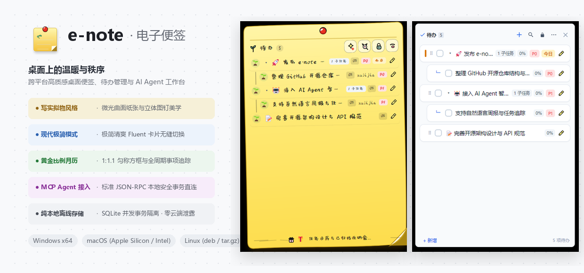
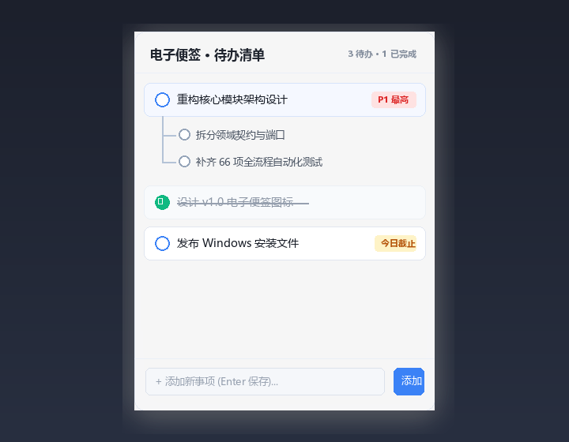
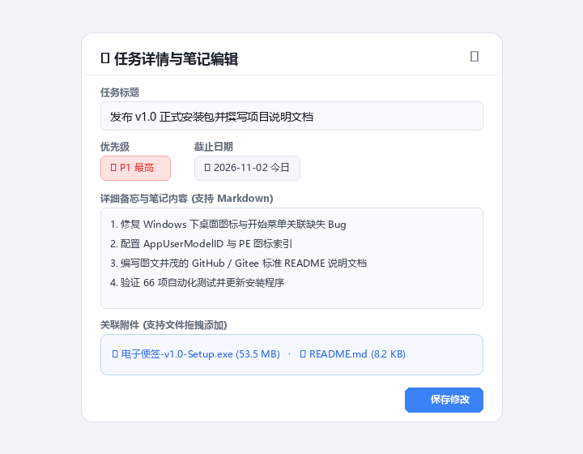
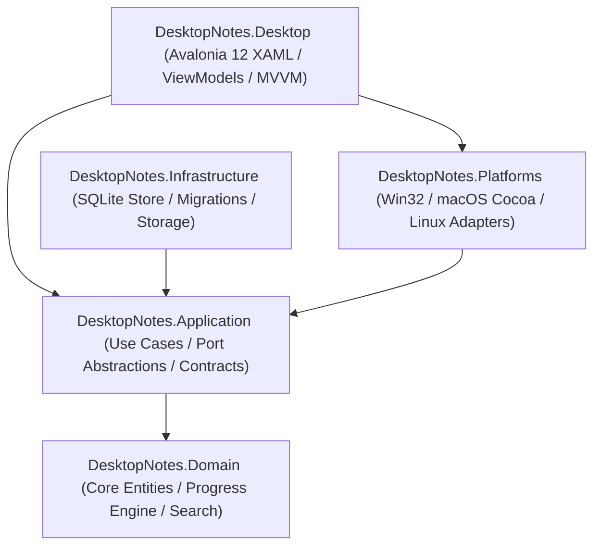

<div align="center">


# e-note · Desktop Sticky Notes

**Warmth & Order on Your Desktop · Cross-Platform High-Aesthetic Sticky Notes, Todo Management & AI Agent Workspace**

[English](README_EN.md) | [简体中文](README.md)

[](#-cross-platform-downloads--installation)
[](#-architecture--building-from-source)
[](#)
[-003B57?logo=sqlite&logoColor=white)](#)
[](#-ai-agent-integration-mcp)
[](#-cross-platform-downloads--installation)
[](LICENSE)

<br/>



</div>

---

## 📖 Introduction

**e-note** is an ultra-lightweight, cozy, and aesthetically crafted cross-platform desktop sticky note and task management assistant designed for creators, software engineers, and knowledge workers.

It breaks away from the cold, rigid tabular interfaces of conventional todo apps by harmoniously blending **photorealistic paper skeuomorphism** with a **modern high-performance todo system**:
- Featuring a warm, gently glowing curved paper texture, an authentic 3D red thumbtack, and charming living seedling indicators 🌱;
- Paired with an infinite-level subtask tree, autonomous task progress calculation, a locked 1:1.1 golden-ratio monthly calendar overview, one-click drag undo protection, and secure managed local attachment storage;
- Native cross-platform compatibility across **Windows 10/11**, **macOS (Apple Silicon & Intel)**, and **Linux**, with 100% self-contained packages requiring no pre-installed runtimes;
- Built-in **Model Context Protocol (MCP)** server, seamlessly transforming your desktop notes into a local knowledge base for AI programming assistants and agents (Claude Code, Cursor, OpenCode, Codex, Antigravity) to automate weekly reviews, OKR digests, and sprint debriefs.

---

## ✨ Key Features

### 1. 🎨 Dual Themes: Realistic Skeuomorphism vs. Modern Minimalist

Seamlessly switch between two visual styles in one click via the top thumbtack menu, balancing cozy desktop companionship with laser-focused sprint productivity:

| Visual Style | Design Philosophy & Interaction Experience |
| :--- | :--- |
| **Realistic Note** | Authentic double-layered curved paper sheet, 3D red thumbtack pin with organic drop shadows, subtle paper creases, 3D bottom-right corner peel flap, handwriting typography, and cheerful sprout indicators (seedling 🌱 for pending, pink flower 🌸 for done). |
| **Minimalist Fluent** | Sleek modern semi-transparent card with subtle acrylic blur, crisp geometric status pills, hierarchical tree indent guidelines, and compact data density. |

<div align="center">
  <table border="0">
    <tr>
      <td align="center" width="50%">
        <b>Realistic Note Style</b><br/><br/>
        
      </td>
      <td align="center" width="50%">
        <b>Minimalist Fluent Style</b><br/><br/>
        
      </td>
    </tr>
  </table>
</div>

---

### 2. 🌲 Hierarchical Subtask Tree & Autonomous Progress Tracking

- **Infinite Nested Decomposition**: Break down ambitious goals into parent tasks, subtasks, and granular action items with unlimited depth.
- **Progress Tracking & Automatic Aggregation**:
  - Individually adjust progress (`0%` to `100%`) by dragging the interactive slider or setting progress directly.
  - Parent tasks automatically calculate and aggregate overall progress from all children, displaying a clean real-time percentage badge.
- **Smooth Text Selection & Accidental-Edit Prevention**: Select and copy text smoothly without flickering carets; left-click expands the metadata capsule, while modifications are triggered via right-click context menu to prevent accidental edits.
- **Drag & Drop Reordering & Reparenting**: Grab the drag handle on the left of any item to reorder, or drop an item onto another task to nest it as a subtask.

---

### 3. 📅 Locked 1:1.1 Golden-Ratio Monthly Calendar & Popover Preview

Say goodbye to distorted, stretched calendar grids:

- **Strictly Locked 1:1.1 Aspect Ratio**: Every date box is strictly fixed to `80px × 72px` (aspect ratio 1.11:1). Whether filled with tasks or completely empty, all 42 calendar grid cells maintain uniform, balanced, and aesthetically pleasing rounded rectangles.
- **Dynamic Status Aggregation**: Displays seedling badges `🌱+N` for created items, checkmarks `✓N` for completed items, and clock badges `⏰N` for upcoming deadlines.
- **Hover Popover & Bottom Drawer**: Hover over any date cell to instantly preview scheduled tasks in a floating card; click to open the full drawer below.

<div align="center">
  
</div>

---

### 4. 📝 Task Details, Markdown Notes & Managed Attachments

Double-click any task to enter the dedicated detail workspace:

- **Rich Markdown Notes**: Multi-line scratchpad supporting checklists, code snippets, and structured notes.
- **Managed Drag-and-Drop Attachments**: Drop local files (screenshots, PDFs, archives, documents) directly into the window. Files are safely managed in a dedicated storage repository, remaining intact even if source files are deleted or moved.
- **4 Priority Tiers & Deadline Reminders**: Clearly categorize tasks by P0 (Urgent), P1 (High), P2 (Normal), and P3 (Low), with desktop warning badges for due items.

<div align="center">
  
</div>

---

### 5. 📌 Three Window Display Modes (Normal / Topmost / Desktop-Pinned)

Customize how e-note lives on your screen:

- **Normal Mode**: Behaves like standard application windows, naturally overlapping and stacking.
- **Topmost Mode**: Always floats above all windows for rapid idea capture.
- **Desktop-Pinned Mode**: Embedded seamlessly into the desktop wallpaper layer; remains visible even when pressing `Win + D`.
- **Thumbtack Lock**: Instantly locks window coordinates and size so your notes stay firmly "pinned" where you left them.
- **Auto-Launch at Startup**: Memorizes window bounds, layout, and expand states across system reboots.

---

### 6. ↩️ Undo History & Two-Stage Trash Bin

- **Drag & Drop Undo**: Accidental mis-dragged tasks can be restored with a single click in Settings.
- **Double Safety Shield**: Deleted tasks are moved to the Trash Bin and can be restored anytime; emptying the trash requires explicit secondary confirmation.

---

### 7. 🔒 100% Offline, Local-First & Zero Telemetry

- **Zero Cloud Uploads**: All data is stored in a local SQLite database (`%LOCALAPPDATA%\DesktopNotes\data\app.db` on Windows).
- **WAL Transaction Reliability**: Uses Write-Ahead Logging (WAL) for safe, concurrent ACID transactions with zero file-locking conflicts.
- **Distraction-Free**: Zero ads, zero popups, zero network telemetry, and 100% offline functionality.

---

### 8. 🤖 AI Agent Integration (Model Context Protocol)

`e-note` includes an out-of-the-box **Model Context Protocol (MCP)** server (`integrations/mcp`), bridging your desktop notes with modern AI agents:

```
                    ┌──────────────────────────────┐
                    │     e-note Local Database    │
                    │   %LOCALAPPDATA%\...\app.db  │
                    └──────────────┬───────────────┘
                                   │ (Read-only safe concurrent access)
                    ┌──────────────▼───────────────┐
                    │     e-note MCP Server Core   │
                    │   (integrations/mcp/...)     │
                    └──────────────┬───────────────┘
                                   │ (Standard JSON-RPC 2.0 stdio)
        ┌──────────────────┬───────┴──────────┬──────────────────┐
        ▼                  ▼                  ▼                  ▼
┌───────────────┐  ┌───────────────┐  ┌───────────────┐  ┌───────────────┐
│  Claude Code  │  │    Cursor     │  │  Antigravity  │  │ OpenCode/Codex│
└───────────────┘  └───────────────┘  └───────────────┘  └───────────────┘
        │                  │                  │                  │
        └──────────────────┴─────────┬────────┴──────────────────┘
                                     ▼
                    [Auto-Generate Weekly / Monthly / OKR Reports]
```

- **Zero Third-Party Dependencies**: Written entirely with Python's standard library.
- **Instant AI Report Generation**: Agents can query accomplished deliverables, outstanding items, and overdue notices to draft weekly reports and sprint debriefs automatically.
- **Standalone CLI**: Run `desktopnotes-mcp --report weekly` in your terminal to print a weekly progress summary in one second.

---

## 📦 Cross-Platform Downloads & Installation

All packages are compiled as **self-contained standalone bundles**—**no prior .NET runtime installation required**:

| Operating System | Package Name | File Size | Target Architecture & Description |
| :--- | :--- | :--- | :--- |
| **Windows** | [**e-note-v1.0-Setup.exe**](./e-note-v1.0-Setup.exe) | **37.60 MB** | Windows 10 / 11 (x64), wizard installer with desktop shortcut & start menu |
| **macOS (Apple Silicon)** | [**e-note-v1.0-macOS-arm64.zip**](./e-note-v1.0-macOS-arm64.zip) | **48.66 MB** | M1 / M2 / M3 / M4 / M5 Macs, contains `e-note.app` |
| **macOS (Intel)** | [**e-note-v1.0-macOS-x64.zip**](./e-note-v1.0-macOS-x64.zip) | **50.97 MB** | 64-bit Intel Macs, contains `e-note.app` |
| **Linux (Debian/Ubuntu)** | [**e-note_1.0.0_amd64.deb**](./e-note_1.0.0_amd64.deb) | **46.85 MB** | Ubuntu, Debian, Linux Mint, install via double-click or `dpkg -i` |
| **Linux (Universal)** | [**e-note-v1.0-linux-x64.tar.gz**](./e-note-v1.0-linux-x64.tar.gz) | **46.85 MB** | Arch, Fedora, openSUSE, includes portable binary & `install.sh` |

### Quick Start by Platform

#### 🪟 Windows
1. Download and run `e-note-v1.0-Setup.exe`;
2. Default installation path is configured to `{autopf}\e-note`;
3. Launch `e-note` from your Desktop or Start Menu.

#### 🍎 macOS
1. Download and unzip the matching `.zip` archive to obtain `e-note.app`;
2. Drag `e-note.app` into your `/Applications` folder;
3. If macOS shows an unverified developer prompt, remove the quarantine flag in terminal:
   ```bash
   xattr -dr com.apple.quarantine /Applications/e-note.app
   ```

#### 🐧 Linux
- **Debian / Ubuntu**:
  ```bash
  sudo dpkg -i e-note_1.0.0_amd64.deb
  ```
- **Universal Tarball (Portable)**:
  ```bash
  tar -zxvf e-note-v1.0-linux-x64.tar.gz
  cd e-note-v1.0-linux-x64
  # Option 1: Run directly without installation
  ./bin/DesktopNotes.Desktop
  # Option 2: Register system application shortcut
  sudo ./install.sh
  ```

---

## 🛠️ Architecture & Building from Source

Built with modern **.NET 10** using **Clean Architecture (Domain-Driven / Hexagonal Architecture)**:



### 💻 Build from Source

#### 1. Prerequisites
- Install [.NET 10.0 SDK](https://dotnet.microsoft.com/download/dotnet/10.0) or later.
- Compatible with Windows, macOS, or Linux build hosts.

#### 2. Clone & Run
```bash
# Clone repository
git clone https://github.com/your-username/DesktopNotes.git
cd DesktopNotes

# Build and launch desktop client
dotnet run --project src/DesktopNotes.Desktop

# Run test suite
dotnet test
```

#### 3. Cross-Platform Publish Commands
```bash
# Windows x64 self-contained build
dotnet publish src/DesktopNotes.Desktop -c Release -r win-x64 --self-contained true -p:DebugType=none -p:DebugSymbols=false -o ./publish/win-x64

# macOS ARM64 build
dotnet publish src/DesktopNotes.Desktop -c Release -r osx-arm64 --self-contained true -p:DebugType=none -p:DebugSymbols=false -o ./publish/osx-arm64

# Linux x64 build
dotnet publish src/DesktopNotes.Desktop -c Release -r linux-x64 --self-contained true -p:DebugType=none -p:DebugSymbols=false -o ./publish/linux-x64
```

---

## ⌨️ Common Interactions & Shortcuts

| Action | How to Trigger |
| :--- | :--- |
| **Quick Add** | Type into the bottom input box and hit `Enter` to create a note instantly |
| **Toggle Status** | Click the sprout 🌱 / checkbox to complete or reopen a task |
| **Copy Text** | Drag and select text directly on any task row to copy without carets |
| **View Metadata** | Single-click a task row to expand the capsule bar (due date, assignee, subtasks) |
| **Adjust Progress** | Click or drag the progress bar; parent tasks update in real time |
| **Edit Task Content** | Right-click the task row and select "Edit Content" from the context menu |
| **Reorder / Reparent** | Drag the left handle to reorder; drop onto another task to nest as a subtask |
| **Open Calendar** | Click the calendar icon in the top header to open the monthly view |
| **Open Detail View** | Double-click any task to open the full Markdown scratchpad and attachment manager |
| **Switch Style / Language** | Right-click the top thumbtack to switch Realistic/Minimalist or Chinese/English |

---

## 📄 License

This project is licensed under a **Dual-Licensing Model (GNU GPL v3.0 / Commercial License)**. Free for personal learning, academic research, and open-source contributions under the copyleft terms of GNU GPLv3. Unauthorized commercial repackaging, proprietary closed-source integration, or paid distribution without explicit written permission from the author is strictly prohibited. For commercial licensing inquiries, please contact the author. See [LICENSE](LICENSE) for details.
